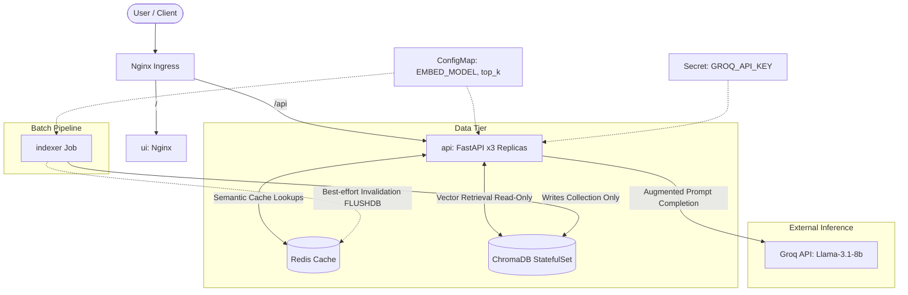

# RAHBAR — Grounded RAG on Kubernetes


RAHBAR is a grounded question-answering service over FAST-NUCES academic policy documents. It answers only from a real document corpus, cites sources for every claim, refuses to answer when the topic is absent, and runs on Kubernetes with 3 API replicas, a semantic cache, and a separate indexing Job.

---

## Architecture

```text
                                +----------------------+
                                |     User / Client    |
                                +-----------+----------+
                                            |
                                            v
                                +-----------+----------+
                                |    Ingress (Nginx)   |
                                +-----+----------+-----+
                                      |          |
                        /-------------+          +-------------\
                        |                                      |
                        v                                      v
            +-----------+----------+               +-----------+----------+
            |      ui (nginx)      |               |  api (FastAPI ×3)    |
            +----------------------+               +----+------+----+-----+
                                                        |      |    |
                            +---------------------------+      |    +--------------------------+
                            |                                  |                               |
                            v                                  v                               v
                +-----------+----------+           +-----------+----------+        +-----------+----------+
                |  Chroma (StatefulSet)|           |     Redis (cache)    |        |   Groq API (external)|
                +-----------^----------+           +----------------------+        +----------------------+
                            | (writes only)
                +-----------+----------+
                |     indexer Job      |
                +----------------------+

                +----------------------+           +----------------------+
                |      ConfigMap       |           |        Secret        |
                | (EMBED_MODEL, top_k) |           |    (GROQ_API_KEY)    |
                +-----------+----------+           +-----------+----------+
                            |                                  |
                            +-----------------> [api, indexer] +------------------> [api]
```



---

## Prerequisites
- Docker Desktop
- minikube
- kubectl
- Python 3.11+
- A free Groq API key from console.groq.com

---

## Cluster Setup
Exact commands:
```bash
minikube start --driver=docker --cni=calico --memory=6144 --cpus=4
minikube addons enable metrics-server
minikube addons enable ingress
```

---

## Kubernetes Apply Order
Exact sequence from a clean clone:
1. Apply the namespace:
   ```bash
   kubectl apply -f k8s/base/namespace.yaml
   ```
2. Apply configuration:
   ```bash
   kubectl apply -f k8s/base/configmap.yaml
   ```
3. Create the secret:
   ```bash
   kubectl create secret generic rahbar-secret \
     --from-literal=GROQ_API_KEY="your-key-here" \
     -n rahbar
   ```
4. Load local container images into Minikube:
   ```bash
   minikube image load rahbar-api:latest
   minikube image load rahbar-indexer:latest
   minikube image load rahbar-ui:latest
   ```
5. Apply all base manifests:
   ```bash
   kubectl apply -f k8s/base/
   ```
6. Wait for the initial indexing Job to complete:
   ```bash
   kubectl wait --for=condition=complete job/indexer -n rahbar --timeout=300s
   ```
7. Verify zero-downtime API rollout:
   ```bash
   kubectl rollout status deployment/api -n rahbar
   ```

Add `/etc/hosts` entry:
```bash
echo "$(minikube ip) rahbar.local" | sudo tee -a /etc/hosts
```

Then open: `http://rahbar.local`

---

## API Reference

| Method | Path | Description | Request | Response |
| --- | --- | --- | --- | --- |
| POST | /api/chat | Ask a question | `{"question": "..."}` | Answer schema |
| GET | /healthz | Liveness check | — | `{"status":"ok"}` |
| GET | /readyz | Readiness check | — | `{"status":"ready"}` or 503 |
| GET | /metrics | Prometheus metrics | — | text/plain |

---

## Running the Indexer
To run or trigger the indexer on demand:
```bash
kubectl create job --from=cronjob/reindex manual-reindex-1 -n rahbar
kubectl logs -f job/manual-reindex-1 -n rahbar
```

---

## Running Evaluation
Run the automated evaluation suite against the golden set:
```bash
python eval/run_eval.py --base-url http://rahbar.local/api
```

---

## Repository Layout
```text
api/            FastAPI service: reads the index, never writes it
  app/schemas.py         the contract
  app/retrieval/         stub.py (given), chroma.py (yours)
  app/providers/llm/     stub.py (given), ollama.py and hosted.py (yours)
  app/services/answer.py retrieve, then generate: add the production steps here
  app/routes/            /api/ask, /healthz, /readyz, /metrics
  tests/                 keep these passing and add your own
indexer/        the Job's image: the only writer
  pipeline/run.py        python -m pipeline.run [--dummy]
  pipeline/{extract,clean,chunk,embed,store}.py   yours
ui/             index.html and nginx.conf (given); the Dockerfile is yours
corpus/         fetch.py, sources.example.yaml; MANIFEST.md once you fetch
eval/           run_eval.py, golden.example.yaml, fixtures/
k8s/            base/ and overlays/{dev,prod}/: empty, yours
docs/           templates for every required document, adr/0000-template.md
scripts/        check_submission.py
.github/        workflows/: empty, yours
```

---

## Security Notes
- `GROQ_API_KEY` lives in a K8s Secret, never committed
- NetworkPolicy denies all traffic by default
- All containers run as non-root

---

## Team
Two-person team. See `docs/AI-USAGE.md` for AI assistance disclosure.
