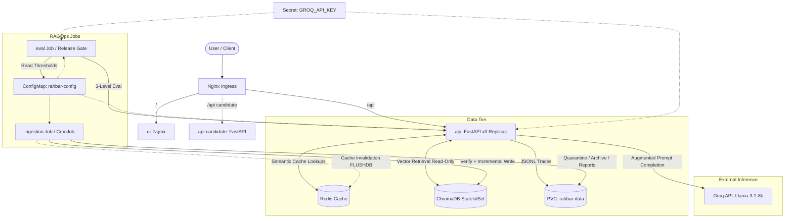

# RAHBAR — Grounded RAG & RAGOps on Kubernetes

[](https://github.com/usmanazhar3105/Rahbar/actions/workflows/ci.yml)

RAHBAR is a grounded question-answering service over FAST-NUCES academic policy documents with a full **RAGOps lifecycle** on Kubernetes. It verifies and incrementally ingests documents, evaluates retrieval and generation across three levels, gates releases via ConfigMaps, logs full JSONL traces with prompt-injection guardrails, monitors live query coverage and drift, and performs zero-downtime canary rollouts and rollbacks.

---

## Architecture

```text
                                +----------------------+
                                |     User / Client    |
                                +-----------+----------+
                                            |
                                            v
                                +-----------+----------+
                                |    Ingress (Nginx)   |
                                +-----+----------+-----+
                                      |          |
                        /-------------+          +-------------\
                        |                                      |
                        v                                      v
            +-----------+----------+               +-----------+----------+
            |      ui (nginx)      |               |  api (FastAPI ×3)    |
            +----------------------+               +----+------+----+-----+
                                                        |      |    |
                            +---------------------------+      |    +--------------------------+
                            |                                  |                               |
                            v                                  v                               v
                +-----------+----------+           +-----------+----------+        +-----------+----------+
                |  Chroma (StatefulSet)|           |     Redis (cache)    |        |   Groq API (external)|
                +-----------^----------+           +----------------------+        +----------------------+
                            | (writes only)
                +-----------+----------+           +----------------------+
                | ingestion / indexer  |---------->|   PVC: rahbar-data   |
                |   Job + CronJob      |           | (corpus, quarantine, |
                +----------------------+           |  archive, traces)    |
                                                   +----------------------+
```



---

## Prerequisites

- Docker Desktop
- `minikube`
- `kubectl`
- Python 3.11+
- Groq API key (from `console.groq.com`) and/or local Ollama (`nomic-embed-text`, `llama3.2:3b`)

---

## Cluster Setup & Kubernetes Apply Order

### 1. Start Minikube Cluster
```bash
minikube start --driver=docker --cni=calico --memory=6144 --cpus=4
minikube addons enable metrics-server
minikube addons enable ingress
```

### 2. Build & Load Container Images
```bash
docker build -t rahbar-api:latest ./api
docker build -t rahbar-indexer:latest ./indexer
docker build -t rahbar-ui:latest ./ui
docker build -f eval/Dockerfile -t rahbar-eval:latest .

minikube image load rahbar-api:latest
minikube image load rahbar-indexer:latest
minikube image load rahbar-ui:latest
minikube image load rahbar-eval:latest
```

### 3. Apply Manifests from a Clean Clone (Exact Order)
```bash
kubectl apply -f k8s/base/namespace.yaml
kubectl apply -f k8s/base/serviceaccounts.yaml
kubectl apply -f k8s/base/pvc.yaml
kubectl apply -f k8s/base/configmap.yaml
kubectl create secret generic rahbar-secret \
  --from-literal=GROQ_API_KEY="your-key-here" \
  -n rahbar
kubectl apply -f k8s/base/chroma-statefulset.yaml
kubectl apply -f k8s/base/redis-deployment.yaml
kubectl apply -f k8s/base/services.yaml
kubectl apply -f k8s/base/api-deployment.yaml
kubectl apply -f k8s/base/ui-deployment.yaml
kubectl apply -f k8s/base/networkpolicy.yaml
kubectl apply -f k8s/base/ingress.yaml
kubectl apply -f k8s/base/hpa.yaml
kubectl apply -f k8s/base/ingestion-cronjob.yaml
```

Wait for the API rollout and run initial ingestion:
```bash
kubectl apply -f k8s/base/ingestion-job.yaml
kubectl wait --for=condition=complete job/ingestion -n rahbar --timeout=300s
kubectl rollout status deployment/api -n rahbar
```

Add host resolution for Ingress:
```bash
echo "$(minikube ip) rahbar.local" | sudo tee -a /etc/hosts
```

---

## Assignment 03 — RAGOps Exact Commands (Parts A to F)

### Part A: Data Management (Verification, Incremental Ingestion, & Batch B)
```bash
# 1. Generate Batch B (10 stress-test documents with planted faults)
python scripts/create_batch_b.py

# 2. Run verification + incremental ingestion locally (from indexer/)
cd indexer
CORPUS_DIR=../corpus/batch_b \
QUARANTINE_DIR=../data/quarantine \
ARCHIVE_DIR=../data/archive \
REGISTRY_PATH=../data/registry/versions.json \
RESULTS_DIR=../data/results \
python -m pipeline.run

# 3. Run second ingestion on unchanged corpus (verifies 0 chunks embedded)
CORPUS_DIR=../corpus/batch_b python -m pipeline.run

# 4. Run Part A unit tests (verification checks + rollback)
pytest tests/test_verify.py -v
```

On Kubernetes:
```bash
kubectl apply -f k8s/base/ingestion-job.yaml
kubectl logs -f job/ingestion -n rahbar
kubectl create job --from=cronjob/ingestion manual-ingest-2 -n rahbar
kubectl logs -f job/manual-ingest-2 -n rahbar
```

---

### Part B: Offline Testing at Three Levels
```bash
# 1. Validate the 32-question golden set (eval/golden.jsonl)
python eval/validate_golden.py

# 2. Run full 3-level evaluation + stochasticity check (writes timestamped JSON to eval/results/)
python eval/run_eval.py \
  --base-url http://rahbar.local/api \
  --golden eval/golden.jsonl \
  --output eval/results/ \
  --thresholds eval/thresholds.yaml
```

---

### Part C: Change Experiment & Release Gate
```bash
# 1. Compare baseline vs candidate across all 3 levels
python eval/compare_runs.py \
  --baseline eval/results/eval_baseline.json \
  --candidate eval/results/eval_candidate.json

# 2. Run release gate on PASSING candidate (Exits 0)
python eval/gate.py \
  --baseline eval/results/eval_baseline.json \
  --candidate eval/results/eval_candidate.json \
  --thresholds eval/thresholds.yaml

# 3. Run release gate on FAILING candidate (Exits 1)
python eval/gate.py \
  --baseline eval/results/eval_baseline.json \
  --candidate eval/results/eval_failing_candidate.json \
  --thresholds eval/thresholds.yaml
```

---

### Part D: Observability, Traceability, & Guardrail Logging
```bash
# 1. List all recorded query traces (from traces/traces.jsonl)
python scripts/trace_tool.py --list

# 2. Inspect a trace ID: prints exact retrieved context, rebuilds prompt, & verifies SHA-256 hash
python scripts/trace_tool.py <trace_id>

# 3. Summarize operational metrics over a time window (top-1 sim, abstention, cache hit, p95 stage latency, injections)
python scripts/summarize_traces.py --trace-file traces/traces.jsonl
python scripts/summarize_traces.py --trace-file traces/traces.jsonl --last-hours 24

# 4. Inspect live cluster trace stdout & Prometheus /metrics
kubectl logs -l app=api -n rahbar --tail=50
kubectl port-forward svc/api-service 9090:9090 -n rahbar
curl http://localhost:9090/metrics
```

---

### Part E: Drift & Coverage Checking
```bash
# 1. Generate 40 live user queries (28 in-domain, 12 out-of-domain)
python scripts/create_live_queries.py

# 2. Evaluate query coverage against golden set (exits non-zero if below threshold)
python eval/coverage.py \
  --live eval/live_queries.jsonl \
  --golden eval/golden.jsonl \
  --threshold 0.75

# 3. Generate data drift report (before vs after Batch B ingestion)
python eval/drift_report.py \
  --before eval/results/eval_before.json \
  --after eval/results/eval_after.json
```

---

### Part F: Kubernetes RAGOps Execution, ConfigMap Gating, & Rollout Undo
```bash
# 1. Inspect all namespace objects
kubectl get all,pvc,configmap,cronjob,job -n rahbar

# 2. Run evaluation + release gate as a Kubernetes Job
kubectl apply -f k8s/eval-job.yaml
kubectl logs -f job/eval -n rahbar

# 3. Edit ConfigMap threshold live and re-run eval Job without rebuilding image
kubectl edit configmap rahbar-config -n rahbar
kubectl delete job eval -n rahbar
kubectl apply -f k8s/eval-job.yaml
kubectl logs -f job/eval -n rahbar

# 4. Deploy candidate API, evaluate it, promote if gate passes, and test rollback
kubectl apply -f k8s/candidate/deployment.yaml
kubectl apply -f k8s/candidate/eval-job-candidate.yaml
kubectl logs -f job/eval-candidate -n rahbar

kubectl set image deployment/api api=rahbar-api:candidate -n rahbar
kubectl rollout status deployment/api -n rahbar --timeout=120s

# Rollback to previous version and verify trace shows previous collection/embedding
kubectl rollout undo deployment/api -n rahbar
kubectl rollout status deployment/api -n rahbar --timeout=120s
kubectl logs -l app=api -n rahbar --tail=20
```

---

## API Reference

| Method | Path | Description | Request | Response |
| --- | --- | --- | --- | --- |
| POST | `/api/chat` | Ask a question (full RAG + trace) | `{"question": "..."}` | `AskResponse` JSON |
| POST | `/api/ask` | Alias for `/api/chat` | `{"question": "..."}` | `AskResponse` JSON |
| GET | `/healthz` | Liveness probe | — | `{"status":"alive"}` |
| GET | `/readyz` | Readiness probe (Chroma, Redis, pin) | — | `{"status":"ready"}` or `503` |
| GET | `/metrics` | Prometheus metrics | — | `text/plain` |

---

## Repository Layout
```text
api/                 FastAPI service: reads index, guardrails, JSONL tracing
  app/schemas.py         Answer, Citation, Passage, AskResponse contracts
  app/retrieval/         chroma.py (filtering + embedding pin), stub.py
  app/providers/llm/     hosted.py (Groq), ollama.py, stub.py
  app/services/          answer.py, cache.py, guardrails.py, tracing.py
  app/routes/            /api/ask, /api/chat, /healthz, /readyz, /metrics
  tests/                 Unit & integration tests (including D1-D4 tests)
indexer/             Indexer Job image: verification, chunking, incremental store
  pipeline/              extract.py, verify.py, clean.py, chunk.py, embed.py, store.py, run.py
  tests/                 Unit tests for verification, chunking, store, rollback
ui/                  Chat UI served by non-root nginx
corpus/              FAST-NUCES documents, MANIFEST.md, batch_a/, batch_b/
eval/                Evaluation suite, golden.jsonl, live_queries.jsonl, results/, Dockerfile
traces/              Committed query trace samples (traces.jsonl)
k8s/                 eval-job.yaml, base/, candidate/, overlays/{dev,prod}/, k8s/README.md
docs/                REPORT.md, CORPUS.md, PIPELINE.md, FAILURE-ANALYSIS.md, ENGINEERING-NOTES.md, AI-USAGE.md, adr/, evidence/
scripts/             trace_tool.py, summarize_traces.py, create_batch_b.py, create_live_queries.py, check_submission.py
.github/workflows/   ci.yml, cd.yml
```

---

## Security Notes
- `GROQ_API_KEY` lives exclusively in a Kubernetes Secret (`rahbar-secret`), never committed.
- `NetworkPolicy` defaults to deny-all and explicitly permits only required service-to-service paths (`ui` cannot reach `chroma`).
- All containers run as non-root (`UID 1000`) with dropped Linux capabilities and `readOnlyRootFilesystem: true` on API pods (mounting only `/tmp` and `/data/traces` writable).
- Retrieval and query guardrails sanitize prompt injections and log detections in `guardrail_actions`.

---

## Team & Submission Info
- **Abdul Mateen Baig** (`24I-3019`, `mateen-arch`)
- **Usman Azhar** (`24I-3105`, `usmanazhar3105`)
- See [docs/REPORT.md](docs/REPORT.md) for the Assignment 03 RAGOps report and [docs/AI-USAGE.md](docs/AI-USAGE.md) for AI assistance disclosure.
