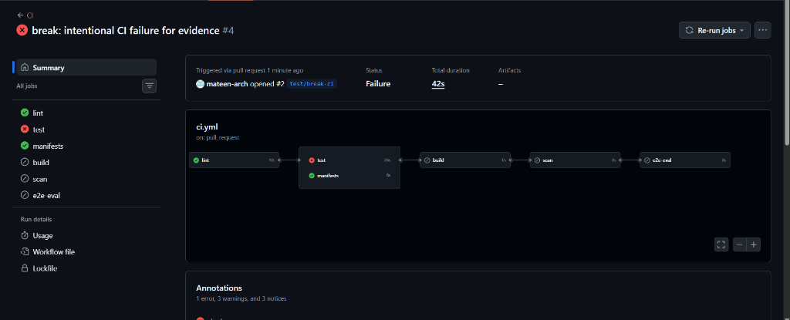

# Blocked Merge Evidence

This evidence demonstrates the enforcement of the CI quality gate on branch `test/break-ci` (PR #2).
When an intentional failure is introduced into unit tests or linting, the `test` CI check fails, thereby blocking merge to `main`.

